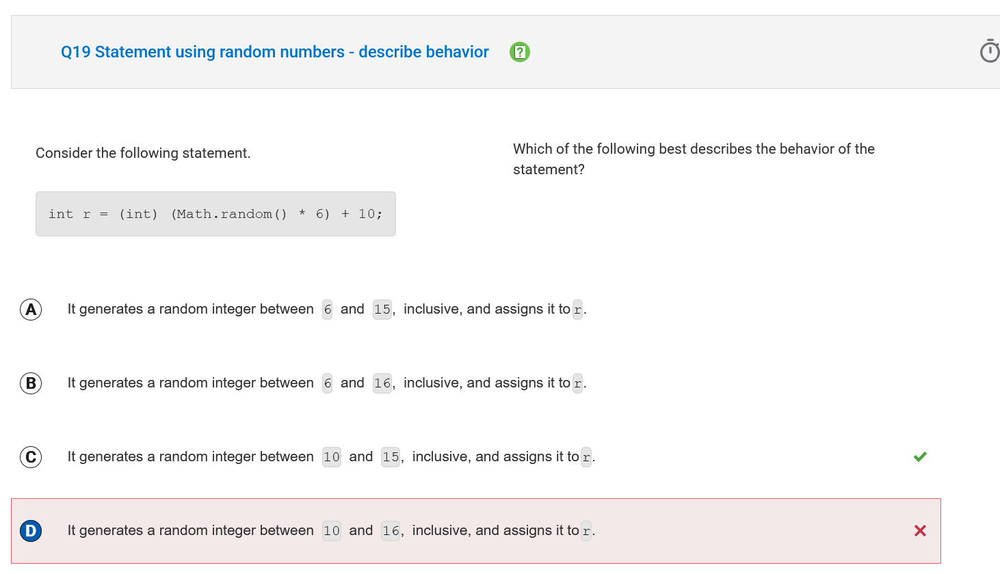

# MCQ Review

Ok so the mcq was lowk a pain in the ass

but i did it :D

## 7

Which of the following expressions can be used to replace /* missing code */ so that this code segment prints the string "HIDE"?

```java
String original = "DEFGHI";
String result = /* missing code */;
System.out.println(result);
```

my answer:
```java
original.substring(4) +  original.substring(0, 1)
```

correct answer:
```java
original.substring(4) +  original.substring(0, 2)
```

I believed that it was inclusive 1 so it would print D and E instead it only prints D

0,2 is correct as it prints D and E

## 9

Which of the following best explains why an error occurs when the classes are compiled?

```java
public class Measurement
{
   private int feet;
   private int inches;

   public Measurement(int numFeet, int numInches)  
   {
      feet = numFeet;
      inches = numInches;
   }

  private int toInches()
  {
     return feet * 12 + inches;
  }
}
```

```java
public class Calculations
{
   public static boolean compare(Measurement m1, Measurement m2)
   {
      if (m1.toInches() >= m2.toInches())
      {
         return true;
      }
      return false;
   }
} 
```

my answer:
The variables feet and inches cannot be accessed from the method toInches.

correct answer:
The toInches method cannot be accessed from a class other than Measurement.

why ?
The problem is not that feet and inches are private.

The real issue is this line:


toInches() is declared as:


and private means:

it can only be used inside the Measurement class itself
it cannot be called from another class like Calculations

So when Calculations.compare(...) tries to call m1.toInches(), Java throws a compile-time error because the method is not accessible outside Measurement.

## 
